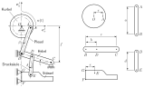
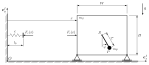

# `MT.PHY3` Maschinendynamik: **Digitale Blöcke**

Mario Weder (wedm@zhaw.ch) und Wilfried Bürzle (buew@zhaw.ch)  
ZHAW School of Engineering  
September 2026  
________________________________________________________________________________

## 01 Kinematik Stanzautomat
.masked.ipynb)

## 02 Kinetik Pendelwagen
.masked.ipynb)

